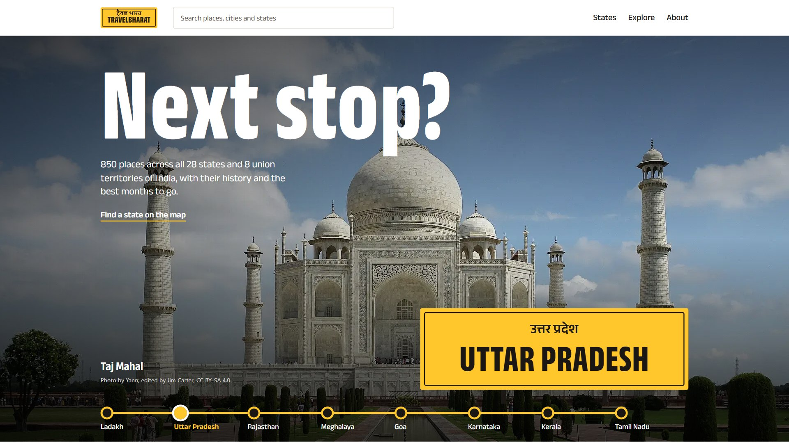
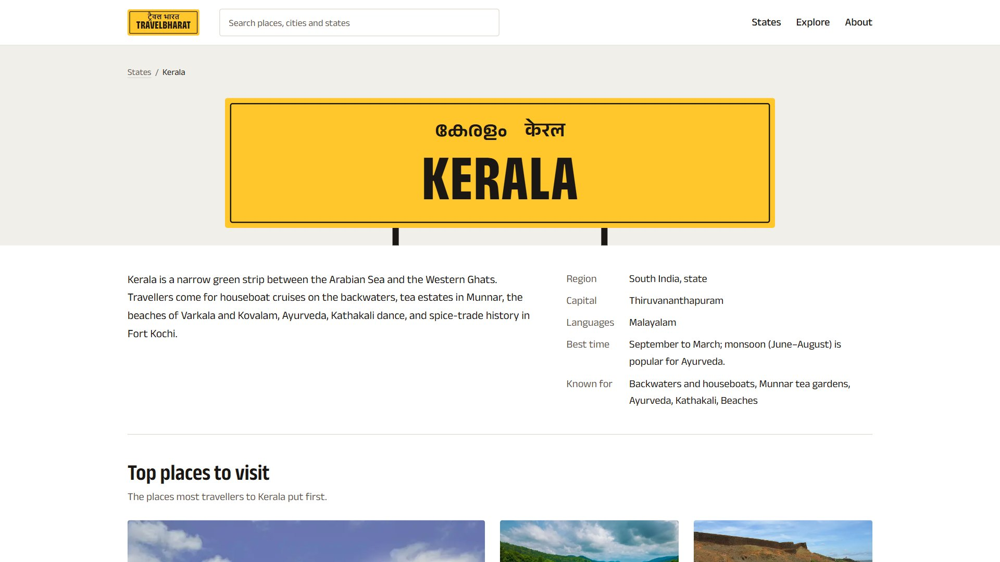
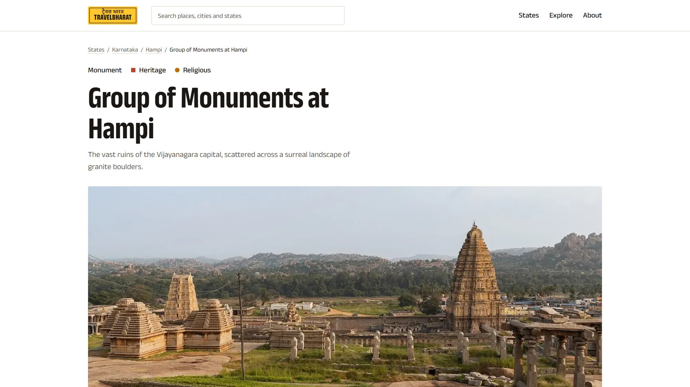
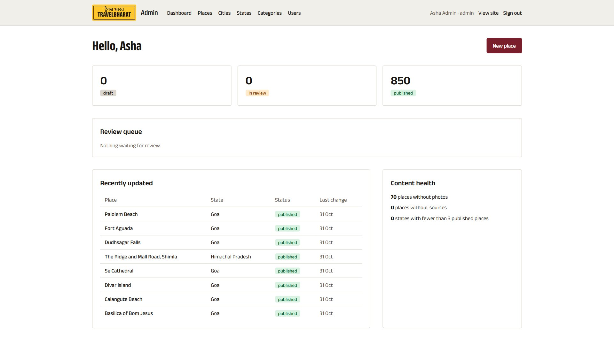

# TravelBharat: Explore India State by State

Detailed project report and product requirements

**Author:** Aditya Belhekar
**Programme:** Internship project, Unified Mentor
**Repository:** https://github.com/AdityaBelhekar/TravelBharat
**Live site:** https://travelbharat-flax.vercel.app



## 1. Summary

TravelBharat is a tourism guide to India, organised state by state and city by city. It covers all 28 states and 8 union territories, with 850 places across 373 cities and 780 credited photographs. Visitors can choose a state from a rail line or a map, browse its places by type, read a place's history and best months, search and filter, and find getaways near a city. Editors and admins manage the content through a secure panel with a review step before anything is published.

## 2. Problem

Information about Indian destinations is scattered across many sites, is inconsistent, and is hard to compare by state. A traveller, student or researcher has to piece it together, which wastes time and makes planning harder.

## 3. Objectives

**Primary**

- Provide one platform for tourist destinations across India.
- Organise places by state and city.
- Offer accurate, sourced travel details.
- Make tourism knowledge easy to access on any device.

**Secondary**

- Promote lesser-known places through a "Hidden gems" collection.
- Support students with sourced, structured information.
- Encourage domestic tourism.
- Leave a sound base for future booking integrations.

## 4. Audience

| Audience | What they need |
|---|---|
| Travellers | Where to go, when to go, and what is nearby |
| Students and researchers | Structured facts with source links |
| Content editors | A simple way to add and update places |
| Administrators | Review and publishing control, and user management |

## 5. Scope

**In scope:** state and city listings, place pages, search and filters, image galleries, an admin panel, and responsive design.

**Out of scope:** bookings, payments, live services, user reviews and social features.

## 6. Requirements and status

| Requirement | Status | How it is met |
|---|---|---|
| Browse by state and UT | Done | State list, home page map and rail line |
| City-wise listings | Done | 373 cities, with histories for major ones |
| Filter by category | Done | Heritage, nature, religious and adventure, plus 24 place types such as forts, beaches and treks |
| Description and historical significance | Done | On place pages |
| Best time to visit | Done | Month strip and notes |
| Entry fees and timings, if applicable | **Partial** | Present on 199 of 850 places. Omitted elsewhere rather than guessed |
| Nearby attractions | Done | Calculated from coordinates with a geospatial query |
| Search by place, state or category | Done | Suggestions as you type, with a full results page |
| Map-based discovery | Done | Clickable India map |
| Image galleries | Done | Gallery on place pages, with photographer and licence credits |
| Add, update and manage destinations | Done | Admin panel |
| Moderation and verification | Done | Editors submit, admins approve, with a review queue |
| Responsive design | Done | Checked at phone width with no sideways scrolling on any page type |
| Fast loading and optimised images | **Partial** | See section 11 |
| SEO-friendly architecture | Done | Pre-rendered pages, metadata, structured data, sitemap, and an SEO score of 100 on measured pages |
| Secure admin access | Done | See section 10 |
| Scalable design | Done | Pre-rendered pages, cached queries and database indexes |

## 7. User flow

1. Open TravelBharat.
2. Choose a state from the rail line, the map or the list.
3. View that state's top places and what to see, grouped by type.
4. Open a place to read its details and see its photos and nearby attractions.
5. Move on to a nearby place, a city's weekend getaways or another state.



## 8. Architecture

| Layer | Technology | Why |
|---|---|---|
| Framework | Next.js 16 with the App Router, and TypeScript | One codebase for pre-rendered pages, server actions and API routes, which suits SEO and speed. It stands in for the suggested separate Express server, and still runs on Node.js |
| Styling | Tailwind CSS v4 | Small CSS output and simple responsive rules |
| Database | MongoDB with Mongoose | Flexible documents, text search and geospatial queries |
| Validation | Zod | The same rules for seed data and admin forms |
| Images | Next.js image optimisation, with Cloudinary for admin uploads | Modern formats at the right size |
| Testing | Vitest, Playwright and ESLint | Unit tests, full user journeys and code checks |
| Hosting | Vercel and MongoDB Atlas | Fast delivery and a managed database |

**How a page is served:** public pages are pre-rendered from the database at build time and cached. When an admin publishes a change, the cache tag is cleared and the affected pages refresh.

**Data model:**

- **Category:** heritage, nature, religious or adventure.
- **State:** name, local names, region, capital, languages and best time.
- **City:** belongs to a state, with an overview, an optional history and a location.
- **Place:** belongs to a state and city, with its type, categories, descriptions, history, best months, optional fees and timings, location, highlights, images, sources and review status.
- **User and LoginAttempt:** for roles and sign-in rate limiting.

## 9. Design

The design takes its idea from the yellow station boards on Indian railway platforms, which show a place's name in the regional script, Hindi and English. Each state gets its own board. The home page opens on a rail line across India: choosing a stop changes the photo and the board.

- **Colour:** board yellow, sign black, coach maroon and platform stone, all drawn from Indian Railways.
- **Type:** the Anek family, which matches across Latin and ten Indian scripts.
- **Category symbols:** map-legend shapes, so categories differ by shape as well as colour.
- **Photographs:** real ones only, with no AI images of real places.

The full reasoning is in [DESIGN.md](../DESIGN.md).



## 10. Security

- Passwords are hashed with scrypt.
- Sessions use a signed, httpOnly cookie.
- Every admin page and server action checks the user's role.
- Failed sign-ins are rate limited.
- All input is validated on the server with Zod.
- Secrets stay in environment variables, and `.env.local` is never committed.



## 11. Testing and performance

**Automated checks**

- ESLint and TypeScript pass.
- All 16 unit tests pass.
- All 4 end-to-end journeys pass on the production build: state browsing, filters, search, and the editor-to-admin publishing flow.
- A production build generates 1,325 pages.
- All 378 Wikipedia source links for the most recently added states were checked and open real pages.

**Lighthouse on a simulated phone, on a local production build**

| Page | Performance | Largest contentful paint |
|---|---|---|
| Home | 87 | 3.7 s |
| States list | 92 | 2.8 s |
| State | 93 | 2.8 s |
| Place | 96 | 2.7 s |
| Explore | 80 | 4.0 s |

Accessibility, best practices and SEO each scored 100 on these pages. The desktop home page scored 98 on performance, with a load of 1.1 s, when measured before the phone work.

Lighthouse's phone test simulates a slow 4G connection and a mid-range device, so real results on faster connections will be better. These numbers should be re-measured on the live site.

## 12. KPIs

| KPI | Target | Status |
|---|---|---|
| Page load time | 2 s or less | Met on desktop. Not yet met on a simulated slow 4G phone test (2.7 to 4.0 s) |
| Content accuracy | 95% or more | **Not yet measured.** Every place links to a source and coordinates were checked, but a sample audit is still needed |
| Monthly active users, engagement, bounce rate | Growth | Can be measured only after launch with analytics |

## 13. Content method

- Candidates and facts came from Wikipedia and Wikidata.
- Coordinates came from those sources or from OpenStreetMap. Places without verifiable coordinates were left out rather than guessed.
- Photos came from Wikimedia Commons under free licences, with the photographer and licence recorded.
- Photos were reviewed by hand, and wrong ones such as maps or general town views were removed or replaced.
- Travel notes flag entry permits and security advice where they matter, such as Ladakh, the Northeast and Kashmir.

## 14. Known limitations

- Depth varies. Maharashtra and the larger states have the most coverage, while the smallest states and UTs have far fewer places.
- Descriptions for many places were written from short source summaries, so they need a manual sample check for accuracy.
- 651 places have no entry fees or timings, and 70 have no usable free photo.
- Phone loading on slow connections is above the 2-second target.
- Some famous places are missing because their location or source could not be verified, such as Patwon ki Haveli.
- Multilingual support is limited to state names on the boards.

## 15. Future enhancements

- Full Hindi and regional language versions
- Complete fees and timings, with a stated date of last verification
- A published accuracy audit
- Trip planning and saved places
- Google Maps exploration
- Booking integrations

## 16. Assumptions and constraints

- Tourism data is publicly available, and sources are reasonably reliable.
- Users have basic internet access.
- The content is informational, with no real-time booking in this phase.
- Content verification is manual.

## 17. Run locally

```bash
npm install
cp .env.example .env.local
npm run seed
npm run create-user -- --email you@example.com --name "Your Name" --role admin
npm run dev
```

## 18. Conclusion

TravelBharat delivers the brief's core product: a structured, sourced, responsive guide to every state and union territory of India, with a moderated admin panel. The clearest next steps are an accuracy audit, completing fees and timings, and faster loading on slow phone connections.
